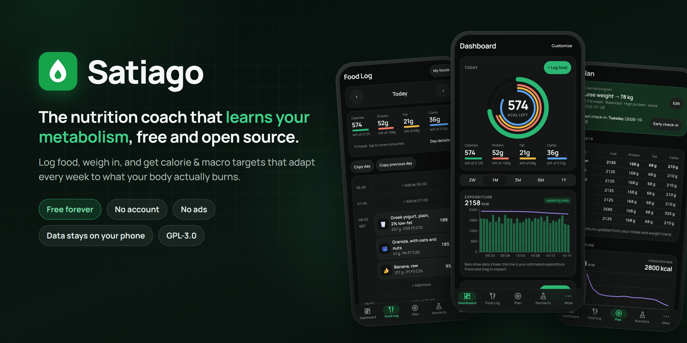
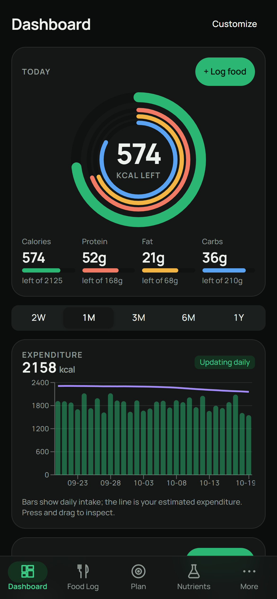
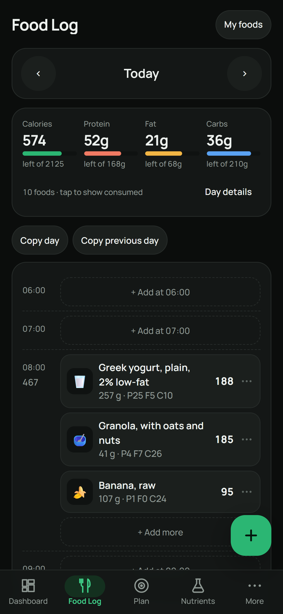
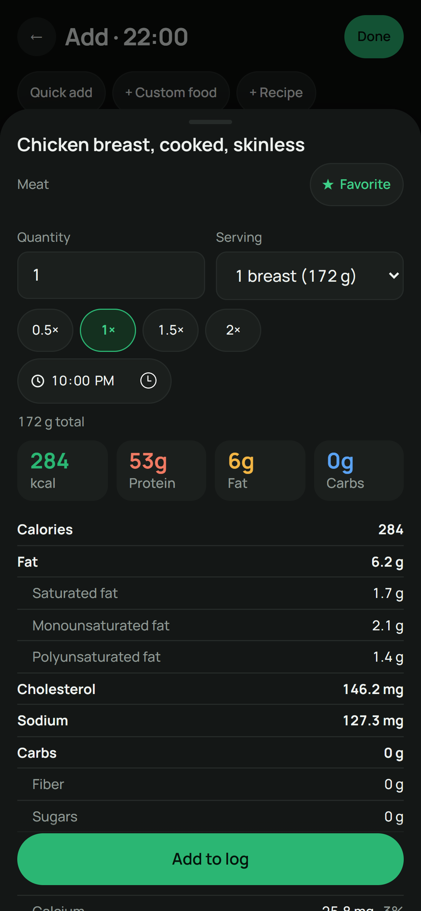
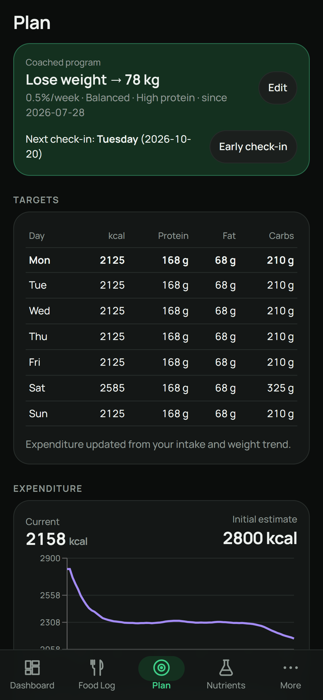
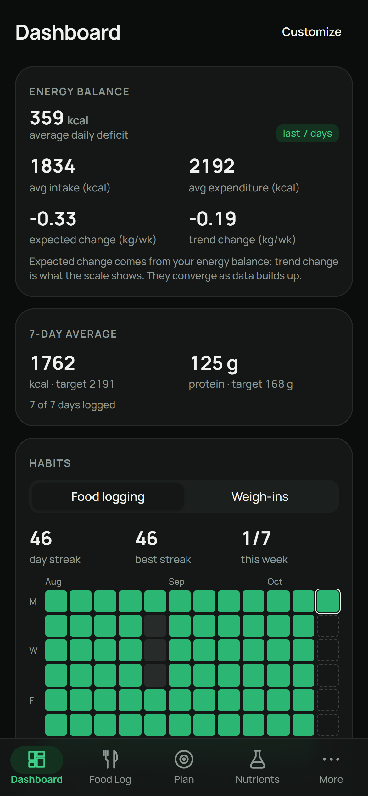
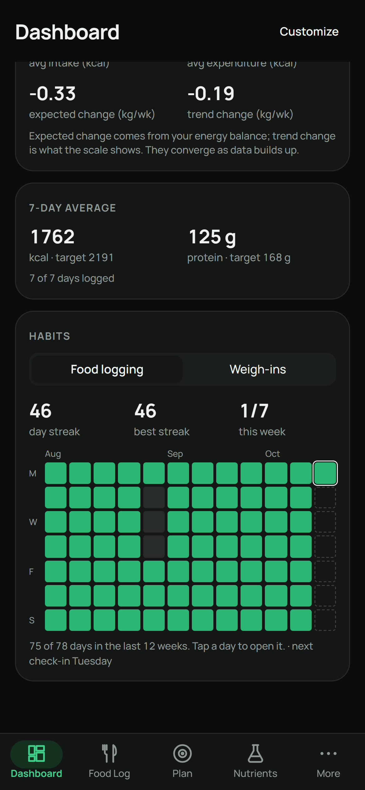
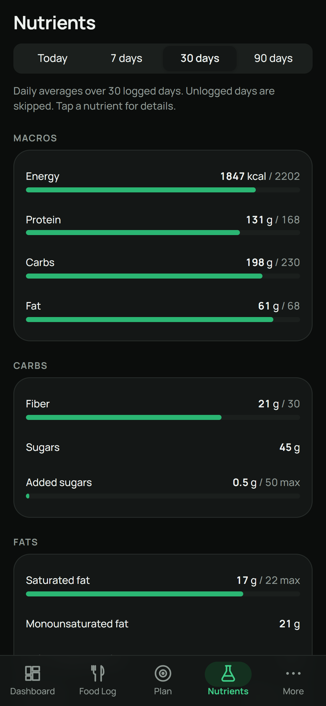
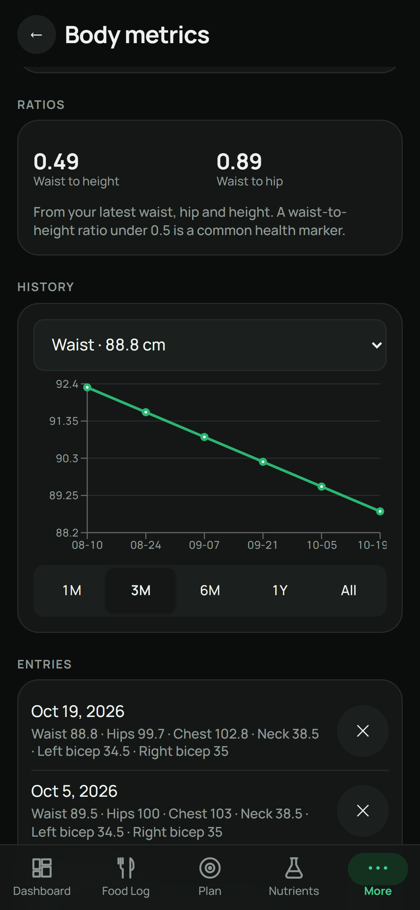
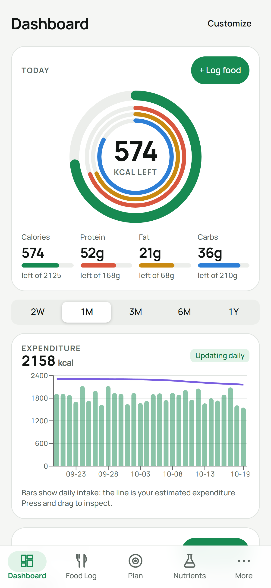

<p align="center">
  
</p>

<p align="center">
  <a href="https://github.com/VladDerK1ng/satiago/actions/workflows/ci.yml"></a>
  <a href="LICENSE"></a>
  
  
  
</p>

<h3 align="center">Log food. Weigh in. Get targets that adapt to what your body actually burns.</h3>

<p align="center">
  Satiago estimates your real daily energy expenditure from your own food log and weight trend,<br>
  then updates your calorie and macro targets every week. Free, open source, and private by design:<br>
  <b>no account, no ads, no subscription, no tracking</b>. Your data stays on your phone.
</p>

<p align="center">
  <a href="https://vladderk1ng.github.io/satiago/"><b>Open the web app</b></a> &nbsp;·&nbsp;
  <a href="docs/INSTALL.md#iphone-and-ipad"><b>Install on iPhone</b></a> &nbsp;·&nbsp;
  <a href="https://github.com/VladDerK1ng/satiago/releases/latest"><b>Download for Android</b></a>
</p>

---

## Install

- **iPhone / iPad:** open <https://vladderk1ng.github.io/satiago/> in **Safari**, tap
  **Share → Add to Home Screen**, then open Satiago from your home screen. It runs full screen and
  offline. [Step-by-step guide](docs/INSTALL.md#iphone-and-ipad)
- **Android:** download the APK from the
  [latest release](https://github.com/VladDerK1ng/satiago/releases/latest) and open it.
  [Guide](docs/INSTALL.md#android)
- **Computer:** open the web app in Chrome, Edge or Safari.

The web version has everything except name search on Open Food Facts, Health Connect and
reminders. [Full comparison](docs/INSTALL.md#what-is-different-between-the-versions)

## Screenshots

<table>
  <tr>
    <td align="center"><br><sub><b>Dashboard</b>: today, expenditure, trend</sub></td>
    <td align="center"><br><sub><b>Food log</b>: hourly timeline</sub></td>
    <td align="center"><br><sub><b>Food details</b>: full nutrition label</sub></td>
  </tr>
  <tr>
    <td align="center"><br><sub><b>Plan</b>: coached weekly targets</sub></td>
    <td align="center"><br><sub><b>Insights</b>: energy balance</sub></td>
    <td align="center"><br><sub><b>Habits</b>: logging and weigh-in streaks</sub></td>
  </tr>
  <tr>
    <td align="center"><br><sub><b>Nutrients</b>: 30+ micronutrients</sub></td>
    <td align="center"><br><sub><b>Body</b>: tape measurements and ratios</sub></td>
    <td align="center"><br><sub><b>Light theme</b> follows your system</sub></td>
  </tr>
</table>

<sub>Screenshots use invented demo data.</sub>

## Features

**Adaptive coaching**
- Expenditure estimated from your intake and weight trend, updated daily, held when data is missing
- Weekly check-ins with explained target changes; coached or manual programs
- Lose, maintain or gain; diet styles; protein preference; calorie floor; higher-calorie days
- Weight trend (robust or simple smoothing), 30-day projection, goal progress

**Food logging**
- Hourly timeline or meal view, swipe to delete or duplicate, multi-select
- Copy a whole day, move foods to another day or time, copy and paste, quick add
- Every entry stays editable: amount, serving, time
- Remembers your usual serving for each food; history sorted by recent or most logged
- Water tracking and day notes; configurable + button shortcuts

**Food database**
- 300+ built-in generic foods with micronutrients
- Offline USDA FoodData Central database: about 12,800 generic foods (Foundation, SR Legacy, FNDDS) with micronutrients and household servings, searched on the device
- On-device barcode scanning and online lookup through [Open Food Facts](https://world.openfoodfacts.org)
- Custom foods, recipes (nested, cooked weight), favorites

**Body and habits**
- Weight, body fat, steps, progress photos, 18 tape-measurement sites with waist-to-height and waist-to-hip ratios
- Optional cycle tracking shown on the weight chart
- Habit calendar for food logging and weigh-ins, streaks, energy-balance insights
- Health Connect sync on Android (opt-in)

**Optional AI assist (bring your own key)**
- Describe or photograph a meal, read a nutrition label, import a recipe
- Works with Anthropic, OpenAI, Google Gemini, OpenRouter, Groq, Mistral, xAI, DeepSeek or any OpenAI-compatible endpoint
- Every AI result is a draft you review; your key is stored in the Android Keystore and never exported

**Your data, your way**
- CSV exports (food log, metrics, foods and recipes), full JSON backup and restore
- Import from other apps' spreadsheet exports (CSV/XLSX), including MacroFactor's export format
- Delete one kind of data at a time, or everything
- 12/24-hour clock, kg/lb, cm/in, kcal/kJ, light and dark themes

## How the coaching works

Satiago keeps a smoothed **weight trend** that filters out day-to-day water swings. Expenditure is
energy balance — what you logged minus the energy your body stored — read two independent ways and
averaged:

```
expenditure ≈ average intake − weight slope (kg/day) × energy density (kcal/kg)
```

1. A **rolling regression** fits a line through your weigh-ins of the last weeks (recent ones count
   more, odd ones are down-weighted) and compares its slope with what you ate over the same days.
2. A **Kalman filter** predicts tomorrow's weight from your intake and its expenditure estimate,
   then corrects the estimate by the miss — the loop MacroFactor describes for its V3 algorithm,
   with the corrections sized by measured noise instead of a hand-tuned constant.

Both use the same physiology. The energy density depends on body composition (Forbes' rule, Hall's
tissue densities): a lean person gains and loses more lean tissue, which stores far less energy
than fat, so it ranges from about 5,000 to over 8,000 kcal/kg. Weight swings from glycogen and its
water after a change in carbs are corrected for when you log carbs. Each estimate shows ± its
typical uncertainty, which shrinks as data builds up. Days you mark as partially logged do not
count, days marked as fasting count as zero, and the estimate is held (not guessed) without a
weigh-in in the last week or when more than 3 of the last 7 days are unlogged. The method, sources
and benchmark are in [docs/EXPENDITURE.md](docs/EXPENDITURE.md). Each week your targets are
recalculated from that expenditure and your goal rate, with protein set per kilogram of body weight
and a calorie floor (never below 1,000 kcal for women or 1,200 kcal for men, and usually higher
because it is tied to your resting energy). People under 18 always get the standard floor and at
most 0.5% weight loss per week.

## Privacy and network

All data lives on the device (IndexedDB; Android cloud backup is disabled). Every network request
goes through one allow-listed, https-only function ([`src/platform/net.ts`](src/platform/net.ts)).
The app only ever contacts:

| Host | When |
|---|---|
| `world.openfoodfacts.org`, `search.openfoodfacts.org` | You search online or scan a barcode that is not saved yet |
| The **one** AI provider host you choose | Only with your own key, and only when you use an AI feature |
| `vladderk1ng.github.io` (GitHub Pages) | Web version only: downloading and updating the app's own files |

The AI host is one of `api.anthropic.com`, `api.openai.com`, `generativelanguage.googleapis.com`,
`openrouter.ai`, `api.groq.com`, `api.mistral.ai`, `api.x.ai`, `api.deepseek.com`, or the https
host of a custom OpenAI-compatible endpoint you enter. Requests are billed to your own account.
There are no analytics, ads, crash reporters or trackers. See the
[privacy policy](public/privacypolicy.html).

## Build from source

Requirements: Node.js 22+, JDK 21, Android SDK (platform 36, build-tools 36).

```bash
npm install
npm test
npm run build
npx cap sync android
```

Debug APK (installable for testing):

```bash
cd android && ./gradlew assembleDebug
```

Signed release APK: create a keystore **outside** the repository, set `SATIAGO_KEYSTORE`,
`SATIAGO_KEYSTORE_PASSWORD`, `SATIAGO_KEY_ALIAS` and `SATIAGO_KEY_PASSWORD`, then run
`./gradlew assembleRelease`. APKs are written to `android/app/build/outputs/apk/`.

Web / PWA: `npm run dev` for development, or `npm run build` and serve `dist/`.

## Tech stack

React 19 · TypeScript · Vite · Zustand · Recharts · Motion · Capacitor 8 (Android) · Google ML Kit
barcode scanning · Vitest

```
src/
  domain/     pure logic: trend, expenditure, targets, nutrition, imports (unit tested)
  platform/   the only code that talks to the device or the network
  pages/      screens
  components/ shared UI (food sheet, search, weigh-in…)
  i18n/       all user-facing text (English; ready for translations)
android/      Capacitor Android project
```

## Contributing

Issues and pull requests are welcome. Please run `npm test` and `npm run lint` before opening a
pull request, and keep user-facing text in `src/i18n`. Translations are especially welcome.

## Disclaimer

Satiago is a tracking tool, **not medical advice**. Calorie and macro targets are estimates.
Talk to a doctor or registered dietitian before changing your diet, especially if you are
pregnant, under 18, have a medical condition, or have a history of disordered eating.

Satiago is an independent project. It is **not affiliated with, endorsed by or connected to**
MacroFactor or Stronger By Science Technologies. "MacroFactor" is a trademark of its owner and is
used here only to describe file-format compatibility.

## License and credits

Satiago is free software under the **GNU General Public License v3.0 or later**, with an
additional permission for linking Google ML Kit / Play services libraries. See [LICENSE](LICENSE)
and [NOTICE](NOTICE).

- Online food data from [Open Food Facts](https://world.openfoodfacts.org), available under the
  [Open Database License](https://opendatacommons.org/licenses/odbl/1-0/)
- Built-in food values approximate [USDA FoodData Central](https://fdc.nal.usda.gov) (public domain, CC0 1.0); the offline
  database is converted from its Foundation, SR Legacy and FNDDS datasets by `scripts/build-usda.mjs`
- [Manrope](https://github.com/sharanda/manrope) typeface, SIL Open Font License 1.1 ([text](LICENSES/OFL-1.1.txt))
- Barcode scanning on Android by Google ML Kit (on-device, with its diagnostics upload disabled);
  on the web by [zxing-wasm](https://github.com/Sec-ant/zxing-wasm) (MIT)
- All bundled JavaScript libraries and their licenses: [third-party-licenses.txt](public/third-party-licenses.txt)
